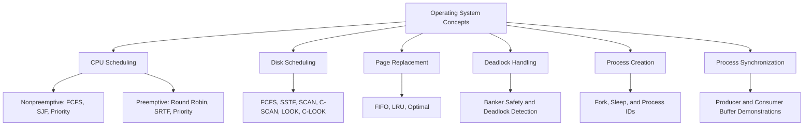

<a id="top"></a>

<div align="center">

# Operating System Algorithms

### Scheduling, memory, resources, and processes — explored in C

A practical collection of operating system lab programs, worked examples, and command references.<br>
Trace a scheduling decision, follow a page replacement, or explore how a process creates a child.


[Quick start](#quick-start) · [Program library](#program-library) · [Lab documents](#lab-documents) · [Learning path](#learning-path)

</div>

## About the collection

This repository contains **27 standalone C programs** and **nine Word lab documents** covering CPU scheduling, disk scheduling, page replacement, deadlock handling, process creation, and producer–consumer demonstrations. The documents also include basic Linux commands and shell scripting exercises, with terminal output screenshots.

Most programs are interactive simulations: provide process details, resource matrices, disk requests, or page references and inspect the result. The process creation examples use POSIX calls such as `fork()` to create real child processes.

Use the source files to follow the implementation and the matching lab documents to compare sample inputs and outputs. Each `.c` file has its own `main()` and should be compiled separately.

## Explore the concepts



| Area | Question to investigate | What to inspect |
| :--- | :--- | :--- |
| **CPU scheduling** | Which ready process should run next? | Execution order, waiting time, turnaround time, and Gantt charts where provided. |
| **Disk scheduling** | Which pending disk request should be served next? | Service order and total head movement. |
| **Page replacement** | Which resident page should be replaced? | Frame contents, hits, and page faults. |
| **Deadlock handling** | Can processes finish with the available resources? | Allocation, need or request matrices, and completion checks. |
| **Process creation** | What changes after a process forks? | Parent and child branches, identifiers, and output order. |
| **Process synchronization** | How does a bounded buffer track production and consumption? | Buffer indices, occupancy, and full or empty conditions. |

## Quick start

### 1. Get the repository

```bash
git clone https://github.com/sharvilprabhudesai15/Operating-System-Algorithms.git
cd Operating-System-Algorithms
mkdir -p build
```

You can also choose **Code → Download ZIP** on GitHub.

Use GCC or Clang with C99 support; several programs use variable length arrays. Linux, macOS, or WSL is appropriate for the POSIX process examples. The existing VS Code configuration contains Windows compiler and machine-specific debugger paths, so adjust those paths for your environment or use the terminal commands below.

### 2. Compile and run disk FCFS

```bash
gcc -std=c99 -Wall -Wextra "Disk Scheduling/FCFS.c" -o build/disk_fcfs
./build/disk_fcfs
```

Enter the request count, the request sequence, and the initial head position:

```text
8
98 183 37 122 14 124 65 67
53
```

The relevant output is:

```text
Total Disk Head Movement is : 640
Sequence in which request is scheduled is :
98 183 37 122 14 124 65 67
```

### 3. Try FIFO page replacement

```bash
gcc -std=c99 -Wall -Wextra "Page Replacement/First_In_First_Out.c" -o build/page_fifo
./build/page_fifo
```

Enter nine page references and three frames:

```text
9
1 2 3 1 4 5 1 2 3
3
```

The program displays the frame contents after each reference and ends with:

```text
Page Fault Is 8
```

These two examples were compiled and their sample results checked. Other programs have their own prompt order; for example, optimal page replacement asks for the frame count first. See [implementation notes](#implementation-notes) before running the remaining examples.

## Program library

### CPU scheduling — nonpreemptive

Each algorithm has variants with and without arrival times. The variants without arrival times assume all processes are ready at time zero.

| Algorithm | With arrival times | Without arrival times | Main comparison |
| :--- | :--- | :--- | :--- |
| **First Come First Serve** | [Source](Non%20Premptive%20Process%20Scheduling/First_Come_First_Serve_With_Arrival_Time.c) | [Source](Non%20Premptive%20Process%20Scheduling/First_Come_First_Serve_Without_Arrival_time.c) | Arrival order and CPU idle intervals. |
| **Shortest Job First** | [Source](Non%20Premptive%20Process%20Scheduling/Shortest_Job_First_With_Arrival_Time.c) | [Source](Non%20Premptive%20Process%20Scheduling/Shortest_Job_First_Without_Arrival_time.c) | Choosing the shortest available burst. |
| **Priority scheduling** | [Source](Non%20Premptive%20Process%20Scheduling/Non_Premptive_Priority_With_Arrival_Time.c) | [Source](Non%20Premptive%20Process%20Scheduling/Non_Premptive_Priority_Without_Arrival_Time.c) | Smaller numeric values represent higher priority in these examples. |

### CPU scheduling — preemptive

| Program | Inputs | What to trace |
| :--- | :--- | :--- |
| [**Round Robin**](Premtive%20Process%20Scheduling/Round_Robin.c) | Process count, burst times, and time slice. | Remaining bursts over repeated turns; all processes are assumed ready at time zero. |
| [**Shortest Remaining Time First**](Premtive%20Process%20Scheduling/Shortest_Remaining_Time_first.c) | Burst and arrival times. | The remaining burst selected at each simulated time step. |
| [**Priority scheduling**](Premtive%20Process%20Scheduling/Priority_Scheduling.c) | Burst times, arrival times, and priorities. | The selection condition involving both priority and remaining burst; see the implementation notes. |

### Disk scheduling

| Program | Scheduling idea | What to compare |
| :--- | :--- | :--- |
| [**FCFS**](Disk%20Scheduling/FCFS.c) | Serve requests in input order. | A baseline for service order and movement. |
| [**SSTF**](Disk%20Scheduling/SSTF.c) | Choose the nearest pending request. | Distance from the current head after every selection. |
| [**SCAN**](Disk%20Scheduling/SCAN.c) | Sweep toward a disk boundary, then reverse. | Boundary travel and the return sweep. |
| [**C-SCAN**](Disk%20Scheduling/CSCAN.c) | Sweep in one direction and return to the opposite boundary. | The circular return and how its movement is counted. |
| [**LOOK**](Disk%20Scheduling/LOOK.c) | Reverse at the last pending request in the sweep direction. | Movement saved by avoiding an unnecessary boundary visit. |
| [**C-LOOK**](Disk%20Scheduling/CLOOK.c) | Sweep in one direction, then jump to the first pending request. | Request endpoints compared with physical disk boundaries. |

The sweep implementations process requests above the initial head first. Inspect the code's use of `maxrange` when specifying disk limits; keep the same boundary convention when comparing results.

### Page replacement

| Program | Replacement idea | Output |
| :--- | :--- | :--- |
| [**FIFO**](Page%20Replacement/First_In_First_Out.c) | Replace the page loaded earliest. | Frame trace with fault markers and a total fault count. |
| [**Least Recently Used**](Page%20Replacement/Least_Recently_Used.c) | Replace the page whose last use was furthest in the past. | Frame trace and a total fault count; review initialization before use. |
| [**Optimal**](Page%20Replacement/Optimal.c) | Replace a page whose next use is furthest in the future, or which is never used again. | Frame trace and a total fault count using the supplied reference string. |

### Deadlock handling

| Program | Inputs | What it demonstrates |
| :--- | :--- | :--- |
| [**Banker's algorithm**](Deadlock%20Avoidance%20Schemes/Bankers_algorithm.c) | Maximum claims, allocations, available resources, and an additional request. | `Need = Max − Allocation`, a safety check, and request handling. |
| [**Deadlock detection**](Deadlock%20Avoidance%20Schemes/Deadlock_Detection.c) | Allocation and outstanding request matrices, plus available resources. | Checking whether pending requests can complete as resources are released. |

Both files are stored under `Deadlock Avoidance Schemes`; detection and avoidance are different tasks. Review the fixed pass count and request handling before treating either program as a general solution.

### Process creation

| Program | Demonstration |
| :--- | :--- |
| [**Fork**](Process%20Creation/Fork.c) | One `fork()` followed by output from both processes. |
| [**Multiple fork**](Process%20Creation/Multiple_Fork.c) | Three successive forks: eight processes reach the final print if all forks succeed. |
| [**Process identification**](Process%20Creation/Process_Identification.c) | Branching on the return value of `fork()` to identify parent and child execution. |
| [**Fork and sleep**](Process%20Creation/Fork_and_sleep.c) | Delaying the child before printing its message. |
| [**Fork, sleep, and IDs**](Process%20Creation/Fork_sleep_and_id.c) | Inspecting process and parent identifiers around delays. |

These examples require POSIX process support and the appropriate headers. Output ordering depends on scheduling; a delay is not a substitute for synchronizing processes.

### Producer–consumer demonstrations

| Program | Buffer model |
| :--- | :--- |
| [**With a counter**](Process%20Synchronization/Producer_Consumer_With_Counter.c) | A user-selected buffer size and an explicit occupancy counter. |
| [**Without a counter**](Process%20Synchronization/Producer_Consumer_Without_Counter.c) | A fixed circular buffer, using input and output indices to distinguish full and empty states. |

Both are menu-driven, single-process demonstrations. Their `wait` and `signal` functions receive integers by value; they do not implement working interprocess or thread synchronization.

## Lab documents

Despite its name, the [`PDF/`](PDF) folder contains **Word documents (`.docx`)**. Download them and open them in Microsoft Word, LibreOffice Writer, or another compatible reader to view the code, commands, and screenshots.

| Document | Contents |
| :--- | :--- |
| [**Basic Linux Commands**](PDF/Basic%20Linux%20Commands.docx) | File and directory operations, permissions, pipes and redirection, wildcards, text processing, variables, and regular expressions. |
| [**Shell Codes**](PDF/Shell%20Codes.docx) | Time-based greetings, factorials, Fibonacci numbers, arithmetic, string and number reversal, palindromes, leap years, primes, case statements, sorting, patterns, and appending to files. |
| [**Nonpreemptive Process Scheduling**](PDF/Non%20Premptive%20Process%20Scheduling.docx) | FCFS, SJF, and priority scheduling lab material with sample outputs. |
| [**Preemptive Process Scheduling**](PDF/Premptive%20Process%20Scheduling.docx) | Round Robin, SRTF, and priority scheduling examples. |
| [**Disk Scheduling**](PDF/Disk%20Scheduling.docx) | The six disk scheduling examples and their output screenshots. |
| [**Page Replacement**](PDF/Page%20Replacement.docx) | FIFO, LRU, and optimal replacement examples. |
| [**Deadlock Avoidance**](PDF/Deadlock%20Avoidance.docx) | Banker's algorithm and deadlock detection examples. |
| [**Process Creation**](PDF/Process%20Creation.docx) | Forking, process identification, and sleep demonstrations. |
| [**Process Synchronization Using Semaphore**](PDF/Process%20Synchronization%20Using%20Semaphore.docx) | The two producer–consumer buffer demonstrations. |

Shell exercises are embedded in the document rather than supplied as `.sh` files. Copy one exercise at a time into a plain text script, convert any `//` annotation to a shell `#` comment, and use Bash for exercises containing arrays or arithmetic `for` loops.

## Learning path

1. **Get comfortable in the terminal.** Begin with the Linux command reference and shell exercises.
2. **Follow a process.** Study `fork()` return values and the difference between a process ID and a parent process ID.
3. **Schedule CPU time.** Start with FCFS, then compare SJF and priority scheduling before adding preemption and a time quantum.
4. **Schedule disk access.** Run the same request queue through different policies and explain each change in head movement.
5. **Trace memory references.** Draw the frames after each reference, mark hits and faults, and compare FIFO with optimal replacement.
6. **Reason about shared resources.** Compare safety checks with deadlock detection, then inspect the producer–consumer buffer state.

### Metrics to calculate by hand

| Metric | Calculation |
| :--- | :--- |
| **Turnaround time** | `Completion time − Arrival time` |
| **Waiting time** | `Turnaround time − Burst time` for the single CPU burst model used here. |
| **Average waiting time** | `Sum of process waiting times / Number of processes` |
| **Average turnaround time** | `Sum of process turnaround times / Number of processes` |
| **Total disk head movement** | Sum of absolute differences between consecutive head positions, starting at the initial head. |
| **Page faults** | Count references whose page is absent from the frames. |
| **Remaining resource need** | `Maximum claim − Current allocation` for each resource type. |

For a small CPU check, use FCFS with `(arrival, burst)` pairs `(0, 5)`, `(1, 3)`, and `(2, 1)`. The execution intervals are `P1: 0–5`, `P2: 5–8`, and `P3: 8–9`, giving an average waiting time of **3.33** and average turnaround time of **6.33**. This case was checked against the arrival-time FCFS program.

## Implementation notes

The source files preserve the original coursework examples. The following details help when compiling them or checking results:

<details>
<summary><strong>Platform and compiler setup</strong></summary>

- Compile one source file at a time. Linking the whole collection together introduces multiple `main()` functions.
- The process creation files omit `<unistd.h>` for POSIX calls. Files calling `exit()` also need `<stdlib.h>`; modern C compilers may reject these missing declarations.
- The producer–consumer helper names `wait` and `signal` can conflict with system declarations, including on macOS. They need distinct names before building on affected platforms.
- `Producer_Consumer_Without_Counter.c` also contains an incomplete `printf("process "` statement near the start of `main()`.
- The `.vscode` files refer to the original Windows development environment. They are optional and need local configuration.

</details>

<details>
<summary><strong>Algorithm assumptions and useful review exercises</strong></summary>

- **Input bounds:** arrays have fixed limits, and some programs use one-based indexing or reserve a sentinel slot. Read each declaration before choosing counts; use positive frame counts, process counts, burst times, and time slices.
- **Preemptive priority:** the selection condition requires both a smaller remaining burst and a higher priority. Review this against the intended priority scheduling policy. SRTF and preemptive priority also reserve index `9` as a sentinel.
- **Deadlock checks:** both programs make only three passes. Banker's request handling changes the allocation before checking the new state, without rolling an unsafe request back; the safe-sequence index also needs resetting between checks.
- **LRU:** unused frame entries are not initialized before comparison. Review that initialization and the bounds of the backward reference search.
- **Producer–consumer:** the helpers modify local copies of semaphore values. Real concurrent synchronization requires shared synchronization primitives and concurrent workers.
- **Printed results:** the FCFS program without arrival times labels both averages as waiting time; the second value is the average turnaround time. In the process ID example, the parent's final printed field uses the child PID returned by `fork()` rather than its own parent PID.

</details>

## Repository structure

```text
Operating-System-Algorithms/
├── Deadlock Avoidance Schemes/         # 2 C programs
├── Disk Scheduling/                   # 6 C programs
├── Non Premptive Process Scheduling/  # 6 C programs
├── Page Replacement/                  # 3 C programs
├── Premtive Process Scheduling/       # 3 C programs
├── Process Creation/                  # 5 C programs
├── Process Synchronization/           # 2 C programs
├── PDF/                               # 9 Word lab documents
├── .vscode/                           # Editor and debugger configuration
└── README.md
```

Original folder and file spellings are preserved so that links match the repository.

## Contributing

Corrections, clearer sample cases, improved input validation, and explanations of algorithm assumptions are welcome. Include the program name, a reproducible input, the expected result, and compiler details when proposing a fix.

No license file is currently included in this repository.

---

<div align="center">

Maintained by [**Sharvil Prabhudesai**](https://github.com/sharvilprabhudesai15)

Explore the companion collection: [Modern Algorithms & Strategies](https://github.com/sharvilprabhudesai15/Modern-Algorithms-Strategies)

[Back to top ↑](#top)

</div>
